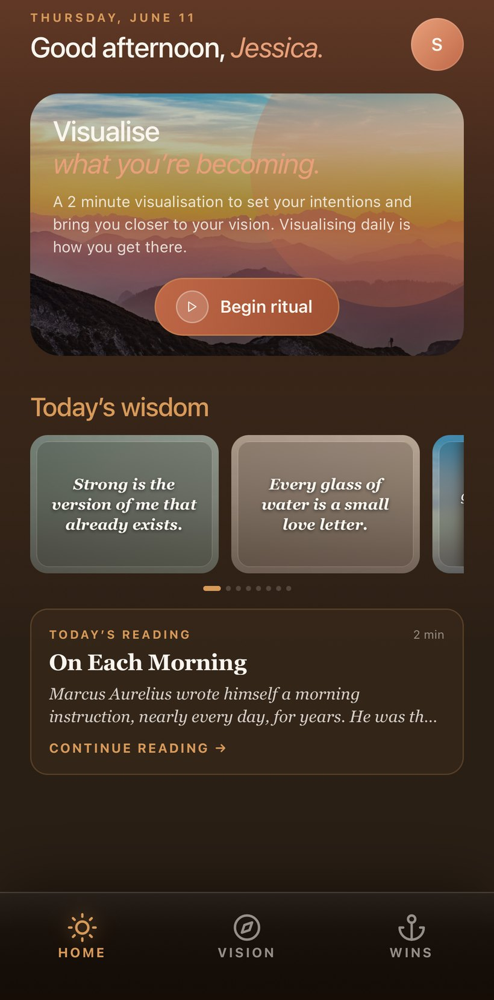
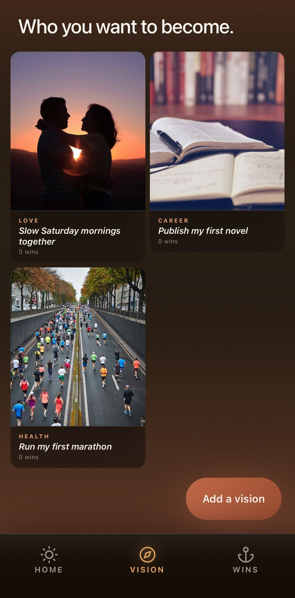
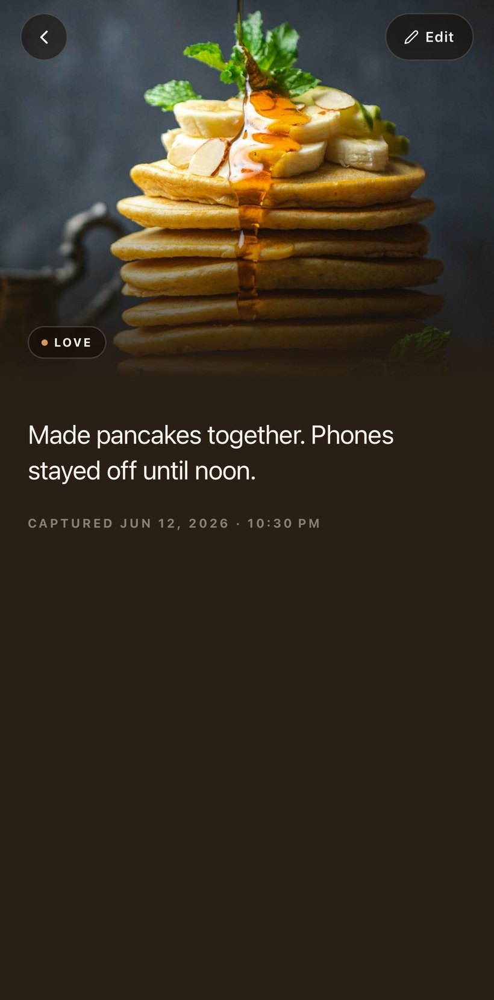
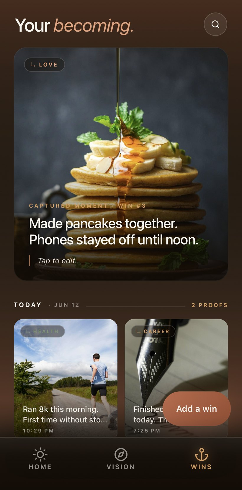

# Visora

A free iOS app for a short daily ritual. You build a vision board of who you want to become, listen to a voice guided ritual of about three minutes each morning, and capture small wins during the day.

Site: [tryvisora.com](https://tryvisora.com)

This repo is a case study. The app's source code is private.

| Home | Vision board | Capture a win | Wins |
|---|---|---|---|
|  |  |  |  |

## What it does

- **Vision board:** pick life areas, add photos and write a statement in your own words.
- **Morning ritual:** a voiced ritual with real pauses that plays over your vision board.
- **Wins:** short notes and photos tagged to a vision area, kept as a timeline.
- **Daily reading:** one short reading on the home screen each day.

All data is stored on the device with Zustand and AsyncStorage, and the ritual audio is bundled with the app. There is no backend in the current version.

## How I built it

I built Visora on my own, using AI tools at each stage.

1. **Design:** I explored the screens as interactive HTML mockups in Claude Design and compared several versions of each screen side by side before choosing one.
2. **Build:** I built the app with Claude Code in numbered review rounds. In each round I reviewed the app, listed what felt wrong and fixed it in the next round. The app went through about 70 rounds.
3. **Voice:** the ritual voice is generated with the ElevenLabs API. See below.

## The ritual voice pipeline

The first version used SSML break tags inside one long text to speech call. ElevenLabs caps each break at about three seconds, so the pauses felt rushed for a meditation.

[`scripts/generate-ritual-voices.mjs`](scripts/generate-ritual-voices.mjs) fixes this:

1. The script is a list of short phrases, each with the silence that follows it.
2. Each phrase is generated as its own audio clip.
3. ffmpeg creates silences of the exact length needed (3 to 15 seconds).
4. ffmpeg joins the clips and silences into one track, and afconvert saves it as AAC.

The result is a ritual of about three minutes with pauses that feel natural.

## Stack

| Area | Tools |
|---|---|
| App | Expo, React Native, TypeScript, Expo Router |
| State and storage | Zustand with AsyncStorage, all on the device |
| Visuals and audio | React Native Skia, Reanimated, expo-audio |
| Monitoring | PostHog, Sentry |
| Voice | ElevenLabs text to speech, ffmpeg |
| Website | Static HTML on Vercel |

## What's next

Sync across devices with Sign in with Apple is planned but not built yet.
